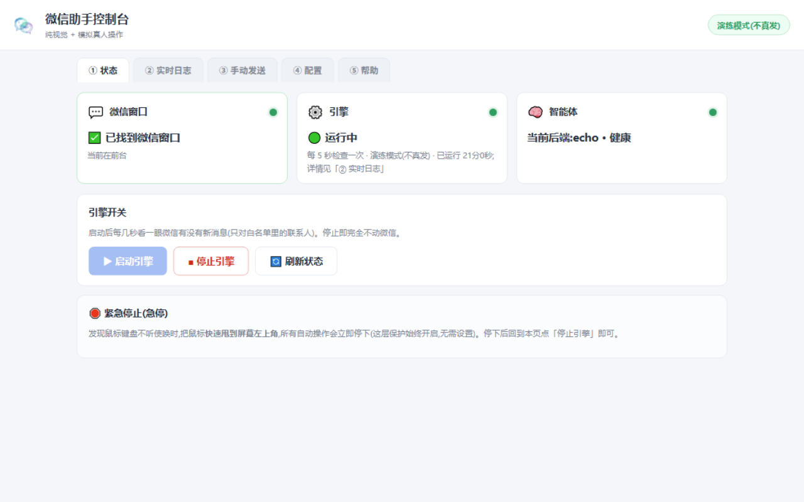
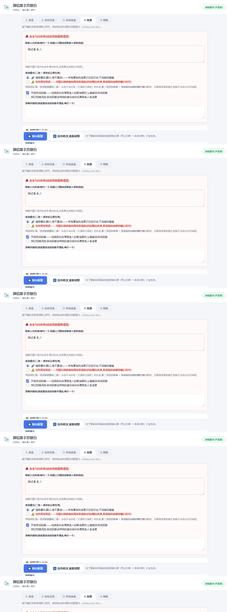
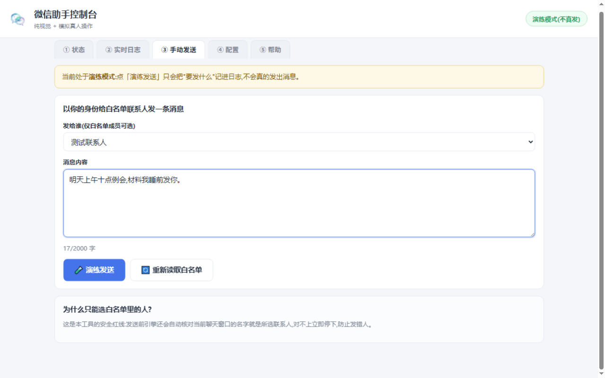
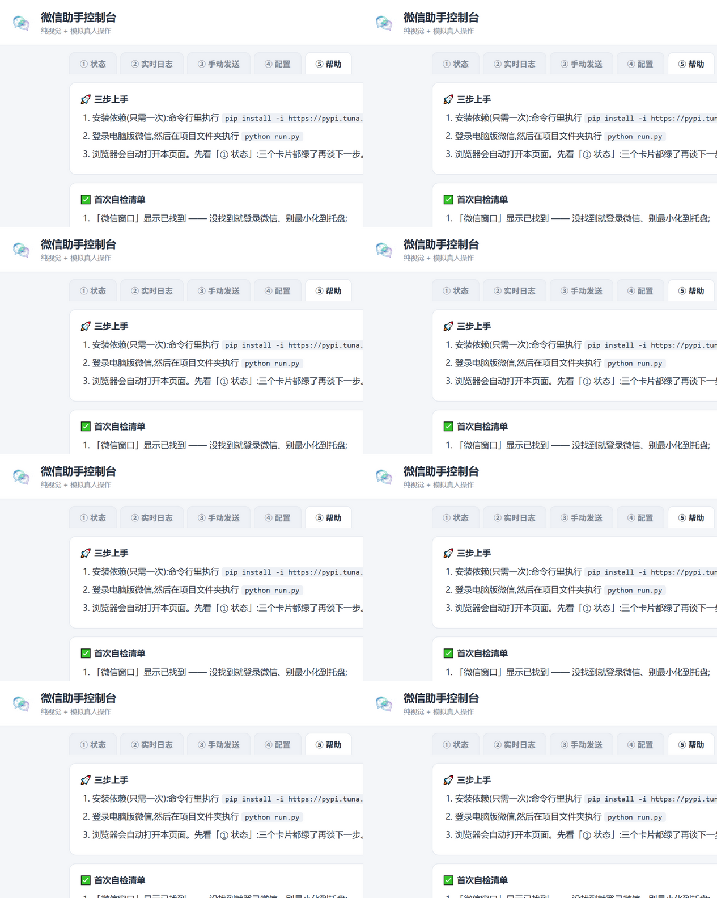
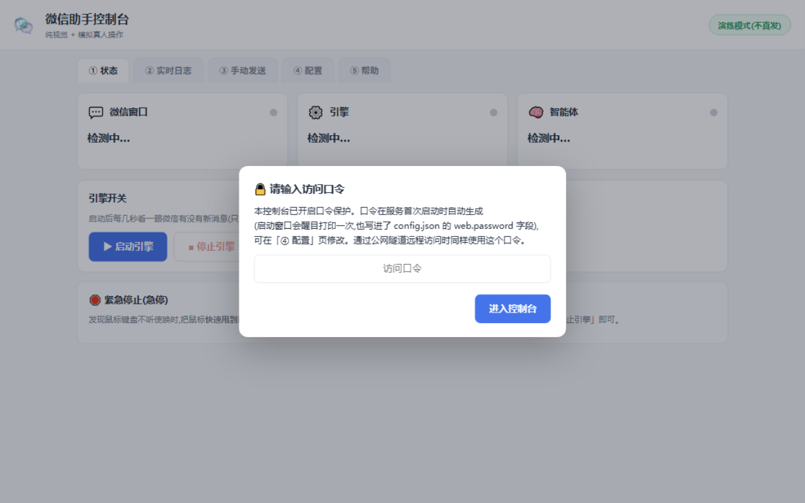

<p align="center">
  
</p>

# WX-Vision —— WX纯视觉自动化助手(WX助手控制台)

一个 **纯视觉 + 模拟真人键鼠** 的WX Windows 客户端自动化助手:截屏 + OCR 读取消息,智能体生成回复,再像真人一样用鼠标键盘发出去。自带中文 Web 控制台,双击就能跑。

- **纯视觉,零注入**:只「看屏幕」和「动鼠标」,不碰WX进程内部;
- **开箱即安全**:默认演练模式(只记录、不发送)+ 白名单(默认只有WX内置的「文件传输助手」);
- **信箱协议接入**:内置 Muse 信箱协议 v1,任何外部程序/智能体都能经 HTTP 轮询取信、回信。

> [!IMPORTANT]
> ## 合规与免责声明(请先读完这段再用)
> - 本项目仅供**个人学习研究**。请只用于自己的WX账号与合法合规的场景;
> - **严禁**用于骚扰他人、群发广告、营销引流、自动添加好友等用途;
> - 自动化操作真人客户端存在**触发WX风控**(限制功能甚至封号)的风险,由此产生的后果由使用者自行承担;
> - 使用本项目即表示你已阅读并同意遵守《微信软件许可及服务协议》。开发者不对任何滥用行为负责。

---

## 一、工作原理

```
        ┌────────────  感知(纯看)  ────────────┐
        │ PrintWindow 截图(窗口被遮挡也能截)     │
        │ RapidOCR 本地识别:文字 + 坐标框 + 置信度 │
        └──────────────────┬───────────────────┘
                           ▼
        ┌────────────  决策  ──────────────────┐
        │ 白名单过滤 → 指纹去重 → 限频检查        │
        │ → 智能体后端(echo/openai/webhook/     │
        │   mailbox)生成回复                    │
        └──────────────────┬───────────────────┘
                           ▼
        ┌────────────  行动(仿真人)  ──────────┐
        │ 贝塞尔曲线鼠标轨迹 + 随机停顿           │
        │ 中文走剪贴板 Ctrl+V,发送前后          │
        │ 都会 OCR 复核窗口标题与输入内容         │
        └─────────────────────────────────────┘
```

明确**不做**的事:

- ❌ 不注入 DLL、不打 hook、不读WX内存;
- ❌ 不读 UIAutomation 控件树(WX 4.x 本来也就读不到了);
- ❌ 不修改、不替换WX的任何文件;
- ❌ 不把你的聊天内容上传到任何开发者的服务器(只有你**自己配置**的智能体后端,比如填了自己 Key 的大模型接口,才会收到消息文本)。

---

## 二、界面截图

| | |
|---|---|
|  |  |
|  |  |
|  | |

> 截图文件若未随仓库分发,可运行后对照实际界面;5 张图依次是:① 状态、④ 配置、③ 手动发送、⑤ 帮助、访问口令登录框。

---

## 三、快速开始

### 环境要求

- Windows 10 / 11;
- Python 3.11 或更高(开发环境为 3.12);
- 电脑版**WX 4.x** 已登录(主界面开着或最小化都行);
- 若导入 onnxruntime 报 MSVCP140.dll 错误,先装微软 [VC++ 2015-2022 运行库(x64)](https://aka.ms/vs/17/release/vc_redist.x64.exe)。

### 第 1 步:安装依赖(只需一次)

```bash
pip install -i https://pypi.tuna.tsinghua.edu.cn/simple -r requirements.txt
```

### 第 2 步:启动

登录WX后,任选其一:

- **双击 `启动WX助手.vbs`**(推荐:无黑框;重复双击不会多开,只会重新打开控制台页面;日志在 `logs/` 下);
- 或命令行执行:

```bash
python run.py
```

常用参数:

| 命令 | 作用 |
|---|---|
| `python run.py --port 8888` | 换端口(默认取 config.json 的 `web.port`,即 8765;被占用会自动顺延) |
| `python run.py --no-browser` | 不自动打开浏览器 |
| `python run.py --config D:\my.json` | 指定配置文件路径 |

关闭服务:双击 `停止WX助手.bat`(只停本项目进程,不碰WX)。

### 第 3 步:进入控制台

浏览器会自动打开 `http://127.0.0.1:8765`。**首次启动会自动生成一个随机访问口令**(至少 12 位),写进 `config.json` 的 `web.password` 字段,并在启动窗口用星号横幅**醒目打印一次**——把它记下来,登录控制台要用。

控制台共 5 个标签:① 状态 / ② 实时日志 / ③ 手动发送 / ④ 配置 / ⑤ 帮助。

### 第 4 步:首次自检(建议按顺序做一遍)

1. **「① 状态」页看三张卡片**:WX窗口「已找到」;引擎「已停止」(正常);智能体显示 `当前后端:echo · 健康`;
2. 保持默认 **echo 模式 + 演练模式**,点「启动引擎」,到「② 实时日志」看日志正常滚动;
3. 用手机给白名单联系人(默认为「文件传输助手」)发条消息,日志里应能看到:`收到新消息` → `调用智能体` → `演练模式·发送意图(未真实发送)`;
4. 一切正常后,若想让机器人**真的**发消息:到「④ 配置」把「发送模式」切成「允许真实发送」(切换和保存时都会再确认一次,且只能发给白名单里的人)。

> 想让控制台从 `config.example.json` 起步:复制一份改名 `config.json` 再启动即可;不复制也没关系,首次启动会自动生成默认配置。

---

## 四、配置(config.json)

配置在 WebUI「④ 配置」页可视化修改,保存前自动备份为 `config.json.bak`;字段与 `config.example.json` 一一对应。重点几项:

### 4.1 联系人白名单

`「④ 配置」→「🚨 安全与白名单」`,**每行一个**联系人名(与WX里显示的昵称/备注一致)。机器人只对白名单内联系人读取和发送;默认名单只有「文件传输助手」(WX内置、人人都有)。名单外联系人的一切消息一律忽略。名单改动后需重启引擎生效。

### 4.2 发送模式(二选一)

| 选项 | 保存时联动写入 | 行为 |
|---|---|---|
| 演练模式(默认) | `engine.dry_run=true` + `allow_real_send=false` | 一切发送只记录"将发送什么",绝不执行键鼠 |
| 允许真实发送 | `engine.dry_run=false` + `allow_real_send=true` | 可能以你的身份真实发消息(仅白名单,发送前 OCR 复核标题) |

两个底层开关由程序保证永远一致,不会出现「又演练又真实」的糊涂状态。

### 4.3 访问口令

控制台所有接口都受口令保护。口令来源与改法见上文「快速开始」;也可在「④ 配置 → 访问口令」页修改,保存立即生效。即使 `config.json` 意外损坏,口令校验也会回退到最近一次成功读取的口令(fail-closed),服务绝不会因此变成免认证。

### 4.4 智能体后端(四类)+ 按联系人路由

「④ 配置 → 智能体后端」可添加/编辑多个后端;「按联系人路由」表指定某联系人固定用哪个后端,没提到的走「默认后端」。

| 类型 | 用途 | 需要填的字段 |
|---|---|---|
| `echo` | 回声测试,零配置零联网,先把链路跑通 | 无 |
| `openai` | GLM / DeepSeek 等 OpenAI 兼容接口 | base_url、api_key、model、system_prompt |
| `webhook` | HTTP 回调,接常驻在线的自有服务(一次请求内立刻回复) | webhook_url、webhook_secret(可选) |
| `mailbox` | **信箱模式**:消息入信箱,由外部程序异步处理,本机不同步回复 | 无同步参数(归档保留时长在卡片内配置) |

`config.json` 等价写法:

```json
"agent": {
  "backends": [
    {"id": "echo-main", "type": "echo"},
    {"id": "glm",       "type": "openai", "base_url": "…", "api_key": "…", "model": "…"},
    {"id": "muse",      "type": "mailbox"}
  ],
  "default_backend": "echo-main",
  "routing": { "某联系人": "muse", "另一联系人": "glm" }
}
```

API Key 在页面上只显示脱敏形式(`sk-****xxxx`),留空保存表示不修改。联系人名填写规则:聊天窗口显示的名字,**备注优先,无备注填昵称**。

### 4.5 其他常用项

- **拟人节奏**(`human` 段):点击落点 ±3px 随机偏移、按前随机停顿、15% 概率偶发犹豫等,默认值即推荐值,一般不用动;
- **限频**(`rate_limit` 段):每联系人每分钟 3 条、全局每分钟 20 条、同联系人 5 秒冷却,超限静默丢弃并记日志——防刷屏、防风控;
- **群聊**(`groups` 段):**默认全关**,引擎连群都不会打开。确需启用请按 WebUI 群聊区的指引逐项开启;群聊真实发送另有「三闸门」(启用群聊 + 群在群白名单 + 群真实发送开关)缺一不可;
- **归档保留**(`mailbox.retention_hours`,默认 48 小时):信箱已确认消息归档保留的时长。

---

## 五、Muse 信箱接入(供外部程序 / 智能体双向通信)

如果你的 AI 程序(协议里叫 **Muse**,任何能发 HTTP 请求的 harness 都行)不是常驻在线、没有公网 IP,推模式走不通——那就走**信箱拉模式**:本助手是唯一常驻服务端,消息进信箱;Muse 定时轮询取信、处理、回信、确认。

**接入步骤(Muse 侧):**

1. 在「④ 配置 → 智能体后端」添加一个 **mailbox 类型**的后端卡片,并把目标联系人路由到它;监听范围 = 私聊白名单 ∪ 群白名单(自动跟随,无需单独配置);
2. 给 Muse 一条能到达本机的通道:
   - **同一台电脑**:直接用 `http://127.0.0.1:8765`(端口跟随 `web.port`);
   - **跨机器**:自备公网通道,例如 Cloudflare 临时隧道一条命令:
     ```bash
     cloudflared tunnel --url http://127.0.0.1:8765
     ```
     (输出一个临时 `trycloudflare.com` 地址,进程退出即失效;固定域名用 named tunnel 方式,见 Cloudflare 官方文档。frp 或任意反向代理同样可用。)
3. **鉴权**:每个请求带请求头 `X-Access-Token: <访问口令>`(即 WebUI 登录口令,兼容 `?token=` 查询参数);
4. 按协议轮询:`GET /api/mailbox/messages?after=<游标>` 取新消息 → `POST /api/mailbox/replies` 回信(原样带回 `chat_id`)→ `POST /api/mailbox/ack` 确认归档。

> 协议全文(8 个端点、字段表、去重/重试/防死循环约定、轮询伪代码)见 **[docs/PROTOCOL.md](docs/PROTOCOL.md)**,Muse 接入前必读。

要点速记:去重唯一依据 `msg_id`;`is_from_me=true` 的消息一律忽略(防死循环);未 ack 的消息会一直重投;范围外的 `chat_id` 回信一律 403 拒收;信箱回复的投递走与手动发送**完全相同的安全闸门**,闸门不放行时终态 `failed` 附中文原因,绝不虚报送达。

⚠️ **口令勿外传,通道即控制权**:公网通道 + 口令 = 谁都能取信、并让机器人以你的身份回信。通道按需开启、用完即关;口令疑似泄露立即到「④ 配置」页修改(立即生效)。

---

## 六、安全模型

1. **两层发送保险**:「发送模式」单选互斥(演练/真实)是第一层;引擎侧白名单 + 发送前 **OCR 复核当前聊天窗口标题就是目标联系人**,不一致立即中止,是第二层——绕不开;
2. **白名单机制**:私聊只对白名单成员收发;群聊默认零触达,启用后仍需群白名单 + 三闸门;
3. **急停**:程序模拟鼠标键盘期间,把**鼠标快速甩到屏幕左上角 (0,0)**,所有动作立即中止(pyautogui FAILSAFE 机制,始终开启,无法也不会被关闭)。然后回控制台点「停止引擎」;
4. **只监听本机**:服务只绑定 `127.0.0.1`,局域网其他人访问不到;请不要把监听地址改成 `0.0.0.0`;
5. **日志有界**:运行日志轮转写入 `logs/bot.log`(约 50MB 上限);WebUI 实时日志为内存环形缓冲,只保留最近 500 条;信箱数据落在 `data/`(已被 `.gitignore` 排除,严禁入库)。

---

## 七、常见问题(FAQ)

**Q:WX窗口显示"未找到"?**
请登录电脑版WX 4.x 并让主界面处于打开状态。最小化到托盘也没关系,引擎启动后会自动恢复窗口。

**Q:WX最小化了会影响吗?**
不影响。引擎需要时会自动恢复窗口并置前(可能闪一下);不需要时你随意最小化。

**Q:日志里出现"空白壳/渲染未恢复"或截到纯色图?**
WX偶发"窗口在但一片空白",程序会自动按 `Ctrl+Alt+W`(WX自带的显示/隐藏热键)反复尝试让WX自己重画,一般几秒内自愈,无需处理。

**Q:启动报错 MSVCP140.dll / onnxruntime?**
先装微软 VC++ 2015-2022 运行库(x64):https://aka.ms/vs/17/release/vc_redist.x64.exe ,装完重启命令行再试。另注意 `opencv-python` 与 `opencv-python-headless` 不可共存(cv2 互踩会段错误),pip 若同时装上两套,卸载其一。

**Q:OCR 第一次特别慢?**
正常。OCR 模型首次加载要几秒到几十秒,之后会变快。

**Q:提示端口被占用 / 浏览器没有自动打开?**
用别的端口启动:`python run.py --port 8888`,然后手动访问 `http://127.0.0.1:8888`。

**Q:机器人为什么没回某人?**
看「② 实时日志」,每条被跳过的消息都写了原因:不在白名单 / 命中忽略词 / 重复消息 / 限频 / 自动回复未开启。

**Q:配置改坏了想恢复?**
每次保存前都会自动备份为 `config.json.bak`;关掉程序,把 `.bak` 改名回 `config.json` 即可。也可直接删除 `config.json`,下次启动会重新生成默认配置。

**Q:想接入 GLM / DeepSeek 等 AI?**
「④ 配置 → 智能体后端」→「添加后端」,类型选 `openai`,填 接口地址 base_url + API Key + 模型名 三项,再到「默认后端」下拉里选中它;填完点「测试连接」验证。想让某个联系人走别的后端,见 §4.4 的按联系人路由。

---

## 八、开发自测(全部离线,零WX触达)

```bash
python tests/test_server.py          # 服务端验收(末行 SERVER_TEST_PASS = 通过)
python tests/test_engine.py          # 引擎验收(ENGINE_TEST_PASS)
python tests/test_mailbox.py         # 信箱协议验收(MAILBOX_TEST_PASS)
python tests/test_group.py           # 群聊离线验收(GROUP_TEST_PASS)
python tests/test_privacy.py         # 隐私扫描:入库文本无隐私残留 + .gitignore 覆盖(PRIVACY_PASS)
python tests/test_launch.py          # 启动器自测(LAUNCH_TEST_PASS)
python tests/test_human.py           # 拟人键鼠画像验收(HUMAN_TEST_PASS)
python tests/test_auth_failclosed.py # 口令 fail-closed 加固验收(AUTH_FAILCLOSED_PASS)
python tests/test_safe_defaults.py   # 出厂默认回归:零发送组合(SAFE_DEFAULTS_OK)
node --check web/app.js              # 前端脚本语法检查(需 Node.js,无则跳过)

# 只读实机验收(需本机WX在登录状态;全程不发送、不碰输入框):
python tests/test_readonly.py        # 目标联系人 = 环境变量 WECHAT_TEST_CONTACT → config 白名单[0] → 兜底"文件传输助手"
```

各套件退出码 0 = 通过。改完代码建议至少跑一遍 server / engine / privacy 三件套。

---

## 九、目录结构

```
WX-Vision/
├── run.py                     # 一键启动:起服务 + 自动开浏览器(默认演练模式)
├── requirements.txt           # 依赖清单(pip 安装用)
├── config.example.json        # 配置模板(复制为 config.json 后按需修改)
├── 启动WX助手.bat            # 无黑框启动入口(内部转调 vbs)
├── 启动WX助手.vbs            # 推荐双击的启动器(无控制台窗口)
├── 停止WX助手.bat            # 停止服务(不碰WX)
├── wxbot/                     # 核心包
│   ├── config.py              # 配置加载/保存/校验/默认值
│   ├── vision/                # 窗口查找与截屏 / OCR / 区域定位
│   ├── actions/               # 仿真人键鼠 / 高层流程(开聊天·读消息·发送)
│   ├── agent/                 # 可插拔智能体后端(echo/openai/webhook)
│   ├── engine/                # 监控引擎 / 安全闸 / 去重与上下文 / 群聊路由
│   ├── mailbox/               # Muse 信箱协议 v1(存储/投递队列/媒体/通知)
│   └── server/                # FastAPI 服务端 + WebSocket 日志
├── web/                       # 单页控制台(原生 HTML/JS/CSS,无构建、无 CDN)
│   └── assets/                # logo / favicon
├── tests/                     # 离线回归 + 只读实机验收(见 §八)
└── docs/
    ├── ARCHITECTURE.md        # 架构设计(技术选型 / 模块契约 / 红线)
    ├── PROTOCOL.md            # Muse 信箱协议 v1(接入必读)
    ├── research/              # 01-03 号调研文档(UI 流程 / 视觉技术栈 / 智能体与 WebUI)
    └── screenshots/           # 界面演示截图
```

运行时还会自动生成(均已被 `.gitignore` 排除,不入库):`config.json`(运行配置,含口令)、`logs/`(日志)、`data/`(信箱数据,含聊天内容)、`tests/_debug/`(调试截图)。

---

## 十、文档索引

| 文档 | 内容 |
|---|---|
| [docs/ARCHITECTURE.md](docs/ARCHITECTURE.md) | 架构与技术选型、模块接口契约、项目红线 |
| [docs/PROTOCOL.md](docs/PROTOCOL.md) | Muse 信箱协议 v1:端点、字段、去重/重试/ack 约定 |
| [docs/research/01-wechat-ui-flows.md](docs/research/01-wechat-ui-flows.md) | WX 4.x 界面操作流程调研(搜索/读消息/发送/未读检测) |
| [docs/research/02-vision-stack.md](docs/research/02-vision-stack.md) | 截屏/OCR/模板匹配/仿真输入技术栈调研 |
| [docs/research/03-agent-webui.md](docs/research/03-agent-webui.md) | 智能体接入与本地 WebUI 设计调研 |
| [README_EN.md](README_EN.md) | English version of this document |

英文版说明见 [README_EN.md](README_EN.md)。
